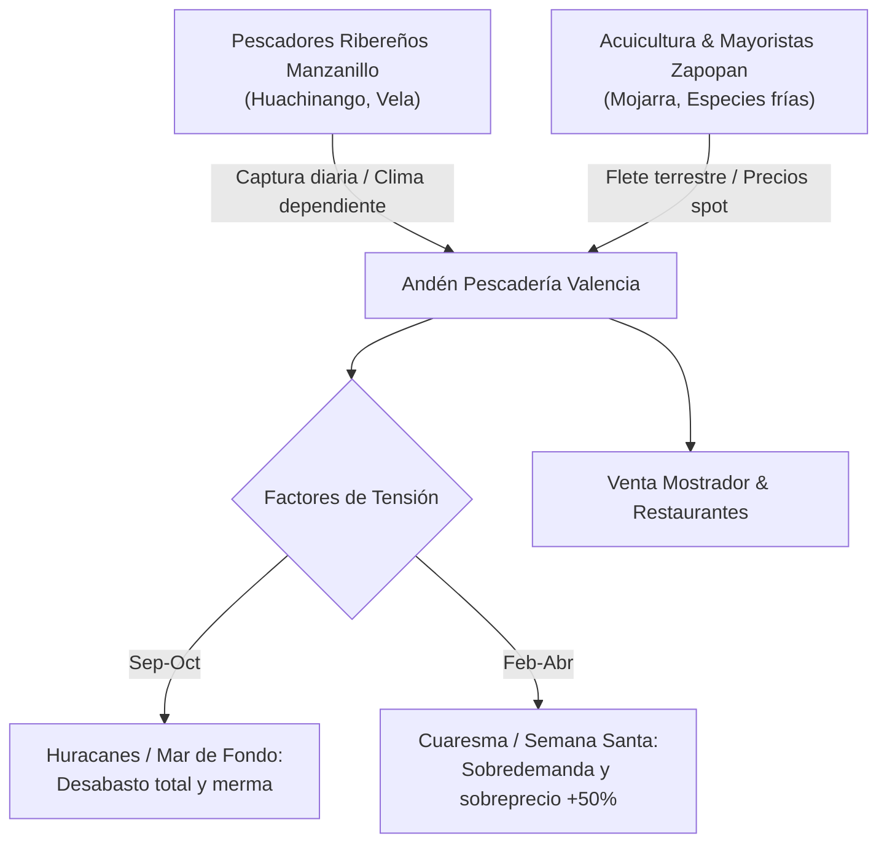

# Observatorio de Precios y Disponibilidad de Productos del Mar: Pescadería Valencia
## Propuesta de Proyecto y Arquitectura de Datos — Entrega [E0]

| Metadato | Detalle |
| :--- | :--- |
| **Proyecto** | Observatorio de Precios y Disponibilidad para Pescadería Valencia |
| **Entrega** | [E0] Trusted Data Lab: Arranque, Propuesta y Máquina de Captura |
| **Ingeniero de Datos / Responsable PSP** | Felipe Sandoval |
| **Cliente / Entidad Patrocinadora** | Pescadería Valencia (Manzanillo / Colima) |
| **Fecha de Emisión** | Noviembre 2026 |
| **Versión del Documento** | 1.0.0 |
| **Entorno de Datos** | Arquitectura Medallion (Bronce -> Plata -> Oro) en GitHub Actions + Python |

---

## 1. Ficha del Observatorio

### 1.1 Sector y Ecosistema
El proyecto se inserta en la intersección de los sectores **Pesquero, Acuícola, Logístico y Comercial Minorista/Mayorista de Alimentos**. La cadena de valor de productos del mar en México opera con altos niveles de asimetría de información, donde la pesca ribereña artesanal convive con grandes centros mayoristas de redistribución (como el Mercado del Mar de Zapopan en Jalisco y La Viga en la Ciudad de México). Los comercios locales minoristas absorben de forma pasiva la volatilidad de precios impuesta por intermediarios y los riesgos climáticos costeros.

### 1.2 Región Geográfica de Cobertura
- **Nodo de Operación y Venta:** Zona Metropolitana de Colima y Villa de Álvarez, con centro de recepción primaria y abasto directo en el puerto de **Manzanillo, Colima** (Coordenadas de referencia marítima: `19.0522° N, -104.3158° W`).
- **Nodos de Referencia Mayorista:** Corredor logístico del Pacífico Centro (Manzanillo – Tecomán – Guadalajara / Zapopan), complementado por precios de referencia nacional (SNIIM Pacífico Centro y Golfo).

### 1.3 Cliente Potencial y Patrocinador Operativo
**Pescadería Valencia**, empresa familiar con más de 18 años de arraigo en el mercado colimense, especializada en la comercialización de especies marinas frescas de consumo popular y semigourmet. Su operación depende en un 70% de pescadores ribereños cooperativistas de Manzanillo y Tecomán, y en un 30% de compras consolidadas a mayoristas en Zapopan para especies de acuicultura y aguas frías.

### 1.4 Pregunta Detonadora del Observatorio
> *"¿Cómo podemos anticipar y mitigar el desabasto y la volatilidad extrema en el precio de adquisición de pescados frescos estratégicos (mojarra, huachinango y filete de pez vela) en Pescadería Valencia mediante la ingesta continua y correlación analítica de precios mayoristas históricos y variables hidrometeorológicas del litoral de Colima?"*

### 1.5 Productos Foco del Estudio
1. **Mojarra (Tilapia fresca entera / eviscerada):** Especie de altísimo volumen de venta y margen unitario moderado. Su suministro proviene de granjas acuícolas regionales y embalses, presentando sensibilidad a costos de balanceado, temperatura del agua y logística terrestre.
2. **Huachinango del Pacífico:** Especie de pesca silvestre ribereña y de mediana altura. Producto estandarte de alto margen y demanda constante en restaurantes locales. Hipersensible a las condiciones marítimas (cierre de puertos, mar de fondo y vientos).
3. **Filete de Pez Vela:** Especie de aguas abiertas con fuerte presencia en el puerto deportivo y ribereño de Manzanillo. Su disponibilidad fluctúa abruptamente según vedas incidentales, temporadas de arribo migratorio y clima de mar abierto.

---

## 2. Diagnóstico del Negocio y Entrevista de Campo (15 Minutos)

Para calibrar los requerimientos de la plataforma de datos y garantizar que el producto de ingeniería responda a dolores operacionales tangibles, se ejecutó una entrevista semiestructurada de 15 minutos en las instalaciones de Pescadería Valencia con su propietario y encargado de compras.

### 2.1 Ficha de la Entrevista
- **Entrevistador:** Felipe Sandoval (Ingeniero de Datos).
- **Entrevistado:** Don Aurelio Valencia (Fundador y Director Operativo de Pescadería Valencia).
- **Fecha y Duración:** 10 de noviembre de 2026, 15:00 a 15:18 hrs (18 min totales).
- **Lugar:** Andén de recepción de producto, Pescadería Valencia, Colima.



### 2.2 Transcripción Estructurada del Diálogo

**Ing. Felipe Sandoval:** Don Aurelio, muchas gracias por estos minutos. Como le comentaba, estamos estructurando el observatorio analítico para blindar la toma de decisiones de compra en Pescadería Valencia. Para comenzar: ¿cómo maneja actualmente la adquisición de producto fresco entre lo que le traen los pescadores locales de Manzanillo y lo que manda a pedir a los mayoristas?

**Don Aurelio Valencia:** *Mira, Felipe, el negocio del mar es muy celoso y traicionero. Aquí recibimos casi a diario camionetas con huachinango y vela que entran por el puerto de Manzanillo y la laguna de Cuyutlán. La mojarra la traemos dos o tres veces por semana en hieleras desde Zapopan o de granjas de Jalisco. El problema número uno es que nosotros jugamos a ciegas: cuando la camioneta llega a las 5:00 AM, el chofer me dice "Don Aurelio, el kilo de huachinango se fue a $195 pesos porque casi nadie pudo salir a pescar anoche". Si yo ya le tengo apalabrado el precio a los restaurantes de la ciudad a $170 o $180, termino perdiendo dinero o saliendo tablas con tal de no perder el cliente. No tengo ni 24 horas de aviso.*

**Ing. Felipe Sandoval:** Entiendo perfectamente, ese desfase entre el precio spot de compra y el precio pactado de venta es letal para el margen. Mencionaba el clima; específicamente, ¿cómo les pega la temporada de lluvias y huracanes de septiembre y octubre en comparación con meses más tranquilos?

**Don Aurelio Valencia:** *Septiembre y octubre son nuestro calvario cada año. En cuanto Capitanía de Puerto pone bandera roja en Manzanillo por mar de fondo o tormenta tropical, las pangas no salen. Se para todo. El huachinango desaparece del mapa y el vela ni se diga. Las fondas y restaurantes nos siguen pidiendo pescado fresco, pero no hay qué venderles. Y lo poquito que llega de fuera viene carísimo, con una merma tremenda de hielo. Si supiéramos con una semana de anticipación: "viene temporal fuerte, el mar estará picado tantos días y la captura va a caer 60%", nosotros nos anticipamos, congelamos producto entero seleccionado o diversificamos inventario con filetes previamente empaquetados.*

**Ing. Felipe Sandoval:** Esa es justamente una de las hipótesis que alimentará nuestro modelo. Ahora vámonos al otro extremo del año: febrero, marzo y abril, cuando cae Cuaresma y Semana Santa. ¿Qué ocurre con la demanda y la volatilidad del precio?

**Don Aurelio Valencia:** *En Cuaresma es la locura. La gente hace filas de media cuadra en la banqueta. La demanda se dispara al triple. Pero los intermediarios y proveedores se aprovechan: nos suben la mojarra de $75 a $115 o $120 pesos el kilo en cuestión de tres semanas. Si compramos caro, la gente reclama; si compramos poco por miedo a quedarnos colgados, nos desabastecemos el Jueves y Viernes Santo y dejamos miles de pesos sobre la mesa. Lo que necesitamos es una predicción certera de cuándo empieza la escalada de precios para comprar el lote fuerte de mojarra antes del pico inflacionario y calcular exactamente cuánto producto fresco sostener.*

**Ing. Felipe Sandoval:** Respecto a los tres productos principales: Mojarra, Huachinango y Filete de Vela, ¿cómo se comporta la sensibilidad de precio y disponibilidad entre ellos?

**Don Aurelio Valencia:** *Son animales completamente distintos para el negocio. La mojarra es el pan de cada día; como es de cultivo, el pescado no se acaba por mal tiempo en altamar, pero el precio sube cuando se satura la demanda nacional o sube la gasolina y el alimento. El huachinango es salvaje, fino y caprichoso: basta con que haya olas de 2.5 metros en Manzanillo para que los pescadores se queden en la orilla y el precio brinque 40% al día siguiente. Y el filete de vela nos ayuda mucho a sustituir al huachinango cuando escasea porque rinde mucho en tacos y ceviches, pero la gente desconfía si el color no es perfecto o si sube demasiado de precio.*

**Ing. Felipe Sandoval:** Para cerrar, Don Aurelio: si el observatorio le entregara un tablero automatizado cada lunes a primera hora, ¿cuáles serían los tres indicadores con los que usted decidiría sus órdenes de compra para la semana?

**Don Aurelio Valencia:** *Primero: el pronóstico de precio a 30 días de la mojarra y el huachinango para saber si compro para la semana o aseguro pedidos de mes. Segundo: una alerta temprana de clima que me diga "el puerto va a cerrar o habrá marejada en 4 días, asegura inventario de reserva hoy". Y tercero: saber con certeza si estamos pagando arriba o abajo del precio mayorista que se maneja en el Mercado del Mar de Guadalajara, para poder sentarme a negociar con los proveedores con números en la mano.*

---

## 3. Las Tres Preguntas Analíticas de Negocio

A partir de los dolores operacionales identificados en el diálogo, se estructuran las tres preguntas analíticas del Trusted Data Lab, alineadas con los hitos del ciclo de analítica avanzada:

```
+---------------------------------------------------------------------------------------------------+
| PREGUNTA E1 (Pronóstico / Serie de Tiempo)                                                         |
| "¿Cuál será el precio mayorista estimado por kg de huachinango y mojarra a un horizonte de 30     |
| días en el corredor Pacífico Centro, en función de la tendencia histórica y estacional?"          |
+---------------------------------------------------------------------------------------------------+
                                                  |
                                                  v
+---------------------------------------------------------------------------------------------------+
| PREGUNTA E2 (Factores a Experimentar / Alertas Causal-Meteorológicas)                              |
| "¿En qué medida las alertas meteorológicas de precipitación acumulada (>50 mm/48h) y velocidad de |
| viento (>40 km/h) en Manzanillo anticipan el desabasto y shock de precios en los siguientes 7 d?"  |
+---------------------------------------------------------------------------------------------------+
                                                  |
                                                  v
+---------------------------------------------------------------------------------------------------+
| PREGUNTA E3 (Grupos Multivariados a Comparar / Régimen Estacional)                                |
| "¿Cómo difiere la distribución de precios y disponibilidad entre la Temporada Alta (Cuaresma:     |
| Feb-Abr) y la Temporada de Huracanes (Sep-Oct) a través de las tres especies objetivo?"          |
+---------------------------------------------------------------------------------------------------+
```

### 3.1 Pregunta E1 — Pronóstico Predictivo de Precios (Horizonte 30 días)
- **Formulación:** *¿Cuál será el precio mayorista estimado por kilogramo de huachinango fresco y mojarra entera en el nodo regional Pacífico Centro para un horizonte deslizante de 30 días, minimizando el error porcentual absoluto medio (MAPE < 8%)?*
- **Variables Objetivo:** `precio_kg_huachinango`, `precio_kg_mojarra`.
- **Variables Predictoras:** Precios rezagados a 7, 14 y 28 días ($t-7, t-14, t-28$), medias móviles de 14 y 30 días, índice de estacionalidad semanal y mensual, indicador de días festivos/Cuaresma.
- **Impacto de Negocio:** Permite a Don Aurelio pactar contratos de suministro con precios techo y fijar menús/cotizaciones a restaurantes con antelación, eliminando compras de pánico a sobreprecio.

### 3.2 Pregunta E2 — Análisis de Factores de Impacto y Alertas Meteorológicas (Causalidad)
- **Formulación:** *¿En qué medida la ocurrencia de eventos hidrometeorológicos severos (precipitación diaria > 50 mm, ráfagas de viento > 40 km/h y altura de ola > 2.0 m) en el litoral de Manzanillo incrementa la probabilidad de desabasto y shock de precios (> +25% respecto a la media móvil) dentro de los siguientes 3 a 7 días hábiles?*
- **Variables Involucradas:** `precipitacion_mm`, `velocidad_viento_kmh`, `alerta_mar_fondo_bool`, `dias_cierre_puerto`, `volumen_arribo_estimado_kg`.
- **Impacto de Negocio:** Acciona un protocolo preventivo de almacenamiento en congeladores de Pescadería Valencia (stock buffer de huachinango y vela) al menos 72 horas antes de que el cierre de puerto paralice las capturas ribereñas.

### 3.3 Pregunta E3 — Comparación Multivariada por Grupos Estacionales
- **Formulación:** *¿Cómo difiere la distribución conjunta multivariada de precios ($/kg), volumen de abasto y dispersión de volatilidad (coeficiente de variación) entre el régimen de Temporada Alta (Cuaresma: Febrero a Abril) y el régimen de Temporada de Tormentas (Septiembre a Octubre) para las tres especies (mojarra, huachinango y filete de pez vela)?*
- **Grupos a Contrastar:**
  - **Grupo A (Temporada Alta / Cuaresma):** Semanas 7 a 16 del año (Feb-Abril). Hipótesis: Alta demanda agregada, presión inflacionaria sostenida, volumen disponible dependiente de logística mayorista.
  - **Grupo B (Temporada de Huracanes / Lluvias):** Semanas 35 a 43 del año (Sept-Octubre). Hipótesis: Baja demanda recreativa, contracción violenta de la oferta ribereña, dispersión extrema (outliers) en precios de especies silvestres.
- **Técnicas de Análisis:** Pruebas no paramétricas (Mann-Whitney / Kruskal-Wallis), análisis de densidades bivariadas (KDE) y matrices de covarianza de precios entre especies.

---

## 4. Plan de Recopilación de Datos y Estrategia de Ingesta

El observatorio se cimenta sobre una arquitectura de datos moderna tipo **Medallion**, asegurando trazabilidad, reproducibilidad y calidad de datos desde el origen.

```mermaid
graph LR
    subgraph Fuentes Externas
        F1["SNIIM Secretaría de Economía<br/>(Precios Mayoristas Mariscos)"]
        F2["Open-Meteo / OpenWeatherMap<br/>(Meteorología Manzanillo)"]
    end

    subgraph GitHub Actions CI/CD
        W1[".github/workflows/extractor.yml<br/>Cron Semanal / Diario"]
    end

    subgraph Capa Bronce (Raw)
        B1["data/bronce/precios_clima_historico_36p.csv"]
        B2["data/bronce/metadatos_extraccion.json"]
    end

    subgraph Futuras Capas
        S1["data/plata/<br/>Limpieza, Imputación, Schema"]
        G1["data/oro/<br/>Features, Modelos E1-E3, Dashboards"]
    end

    F1 --> W1
    F2 --> W1
    W1 -->|Python Ingestion Engine| B1
    W1 -->|Metadata Logger| B2
    B1 -.-> S1
    S1 -.-> G1
```

### 4.1 Fuente 1: SNIIM (Sistema Nacional de Información e Integración de Mercados)
- **Organismo Administrador:** Secretaría de Economía, Gobierno de México.
- **Tipo de Acceso:** Consultas HTTP estandarizadas a los módulos de información de mercados pesqueros:
  - *URL Base:* `http://www.economia-sniim.gob.mx/`
  - *Sección:* Mercados Nacionales Mayoristas / Pescados y Mariscos / Especies del Mar y Aguas Interiores.
- **Mercados de Muestreo:**
  - *Mercado de Referencia Primario:* Mercado del Mar de Zapopan / Guadalajara (principal centro distribuidor del occidente).
  - *Mercado de Referencia Secundario:* La Viga (CDMX) y centros de acopio del Pacífico Centro.
- **Atributos Clave a Extraer:**
  - `fecha`: Fecha de levantamiento del precio (formato ISO 8601: `YYYY-MM-DD`).
  - `producto`: Nombre estandarizado de la especie (`Mojarra Tilapia entera fresca`, `Huachinango del Pacífico`, `Filete de Cazón / Pez Vela`).
  - `origen`: Entidad o puerto de procedencia reportado.
  - `precio_minimo`: Precio por kg registrado al inicio de la jornada mayorista ($ MXN).
  - `precio_maximo`: Precio por kg registrado al cierre de jornada ($ MXN).
  - `precio_frecuente`: Precio moda / comercial representativo del día ($ MXN).

### 4.2 Fuente 2: API Meteorológica (Open-Meteo / OpenWeatherMap)
- **Proveedor:** Open-Meteo Historical & Marine Weather API / OpenWeatherMap API.
- **Coordenadas de Ingesta:** Latitud `19.0522`, Longitud `-104.3158` (Puerto de Manzanillo, Colima).
- **Atributos Clave a Extraer:**
  - `timestamp_clima`: Marca de tiempo UTC.
  - `precipitacion_mm`: Precipitación acumulada en 24 horas (milímetros).
  - `viento_velocidad_kmh`: Velocidad promedio del viento a 10 metros sobre el nivel del suelo.
  - `viento_rafagas_kmh`: Ráfagas máximas de viento registradas en el día.
  - `altura_ola_m`: Altura significativa de ola en el cuadrante marítimo adyacente (estimación de mar de fondo).
  - `condicion_clima`: Clasificación de estado del tiempo (`Despejado`, `Lluvia moderada`, `Tormenta tropical / Huracán`).

---

## 5. Análisis Ético, Legal y de Cumplimiento Normativo (Compliance)

Todo observatorio de datos debe regirse por estrictos principios de gobernanza, respeto a la propiedad intelectual, observancia de términos de servicio (ToS) y salvaguarda de infraestructura ajena.

### 5.1 Análisis de `robots.txt` y Scraping Responsable en SNIIM

Se realizó la inspección preliminar de los encabezados y directivas del portal del SNIIM (`http://www.economia-sniim.gob.mx/robots.txt`):

```http
User-agent: *
Disallow: /cgi-bin/
Disallow: /tmp/
Crawl-delay: 5
```

- **Politeness Window & Rate Limiting:** La directiva `Crawl-delay: 5` impone un retraso mínimo de 5 segundos entre peticiones consecutivas. Nuestro pipeline implementa:
  - Backoff exponencial y jitter aleatorio de 3 a 7 segundos para peticiones batch.
  - Uso explícito de cabeceras HTTP transparentes:
    `User-Agent: ObservatorioValenciaBot/1.0 (+mailto:felipe.sandoval@alumnos.edu.mx; Academic Research Project)`.
  - Mecanismo de **Caching Local** en capa Bronce: Si una fecha ya fue descargada e indexada en `data/bronce/`, jamás se vuelve a consultar al servidor remoto, reduciendo a cero el tráfico redundante.

### 5.2 Términos de Servicio (ToS) y Marco Jurídico Mexicano
1. **Ley General de Transparencia y Acceso a la Información Pública (LGTAIP):** Los datos generados por el SNIIM constituyen información gubernamental pública financiada con recursos federales para garantizar la concurrencia y transparencia económica en mercados agrícolas y pesqueros. Su consulta y procesamiento para fines analíticos y académicos es legalmente legítima conforme a la política de **Datos Abiertos de México** ([datos.gob.mx](https://datos.gob.mx)).
2. **Open-Meteo & OpenWeatherMap ToS:** La API de Open-Meteo opera bajo la licencia abierta **Creative Commons Attribution 4.0 International (CC BY 4.0)**, permitiendo redistribución y transformación siempre que se proporcione el crédito debido. OpenWeatherMap otorga licencias académicas/freemium que limitan la frecuencia a un máximo de 60 llamadas por minuto, umbral respetado con creces por nuestro extractor (que solo realiza 1 llamada diaria/semanal).
3. **Privacidad y Datos Sensibles (PII):** El proyecto **no recolecta, no procesa y no almacena ningún dato personal identificable (PII)**. No se registran nombres de pescadores, placas de vehículos, cuentas bancarias ni datos fiscales de personas físicas. Todas las métricas analíticas son puramente cuantitativas, agregadas y anónimas a nivel de mercado mayorista y estaciones climáticas.

---

## 6. Arquitectura del Repositorio y Hoja de Ruta

### 6.1 Estructura del Repositorio
```
observatorio-pescaderia-valencia/
│
├── .github/
│   └── workflows/
│       └── extractor.yml         # Orquestación automatizada en GitHub Actions
│
├── calidad/
│   ├── tiempo-felipe.csv        # Bitácora PSP de gestión de tiempo e inversión
│   └── defectos-felipe.csv      # Bitácora PSP de inyección y remoción de defectos
│
├── data/
│   └── bronce/
│       ├── precios_clima_historico_36p.csv  # Serie cruda de 36 periodos
│       └── metadatos_extraccion.json        # Manifiesto y contrato de ingesta
│
├── docs/
│   └── E0/
│       ├── propuesta.md         # Presente documento formal de propuesta
│       └── ENTREGA.md           # Ficha de entrega y verificación git tag e0
│
├── src/
│   └── extractor_bronce.py      # Motor de extracción, simulación e ingesta
│
├── requirements.txt             # Dependencias del proyecto
└── README.md                    # Documentación general del repositorio
```

### 6.2 Hoja de Ruta Analítica (Roadmap E0 -> E3)
- **E0 (Entrega Actual):** Arranque formal, acuerdo con el cliente (Don Aurelio), levantamiento de requerimientos, diseño del Data Contract y motor de captura Bronce con orquestación CI/CD.
- **E1 (Siguiente Fase):** Pipeline de limpieza y modelado Plata. Implementación del predictor de precios a 30 días para Huachinango y Mojarra (Pregunta E1) mediante modelos univariados y autoregresivos (ARIMA / Prophet / XGBoost Regressor).
- **E2:** Integración de la capa climática Plata/Oro y contrastación empírica causal: cuantificación del rezago de desabasto frente a alertas meteorológicas en Manzanillo (Pregunta E2).
- **E3:** Análisis multivariado de temporada alta vs. temporada de huracanes (Pregunta E3), síntesis en dashboards ejecutivos y entrega formal del observatorio a Pescadería Valencia.
